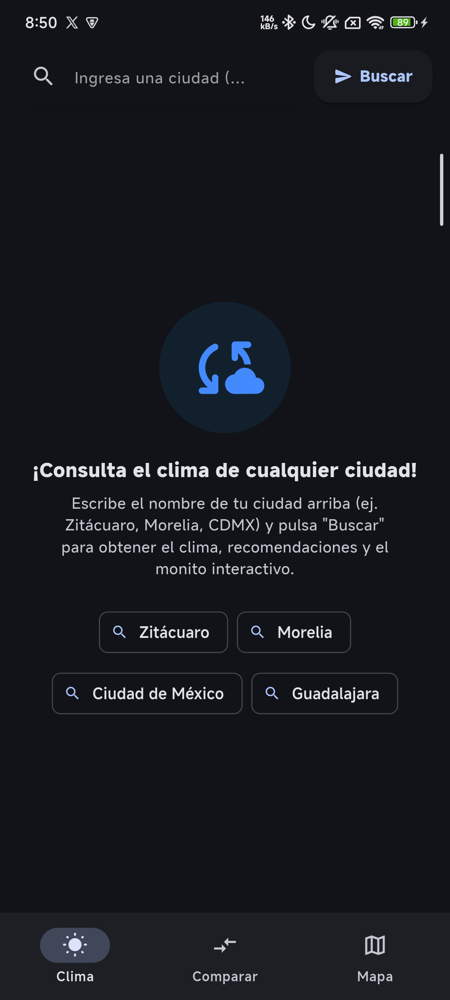
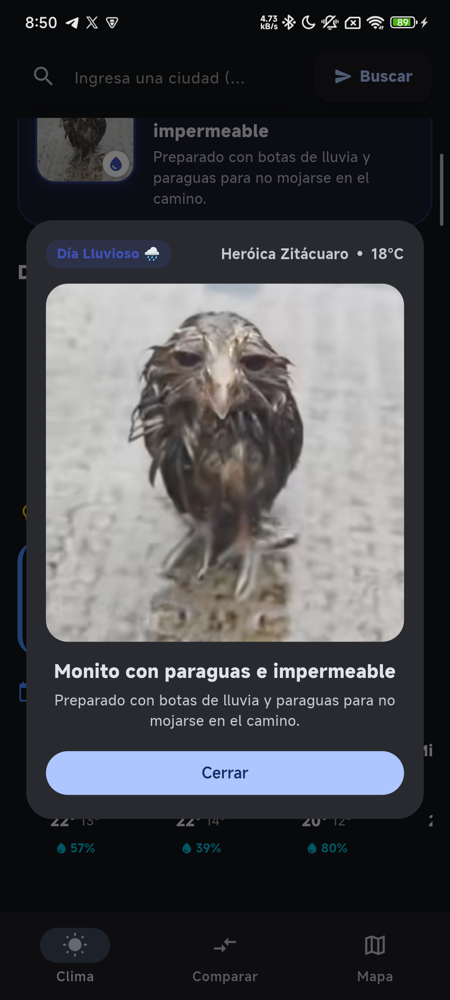
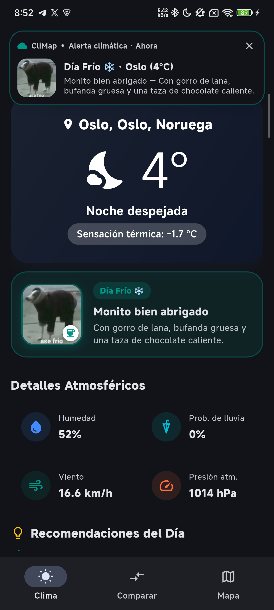
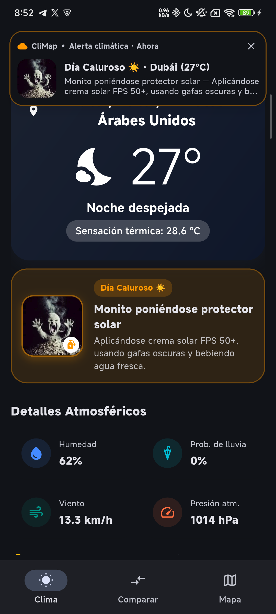
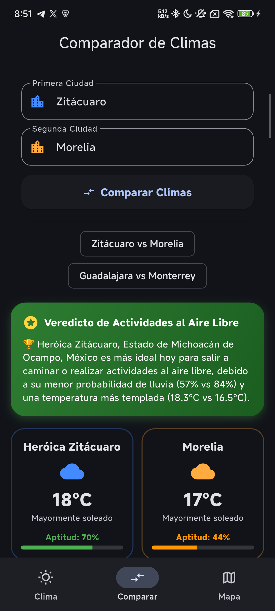
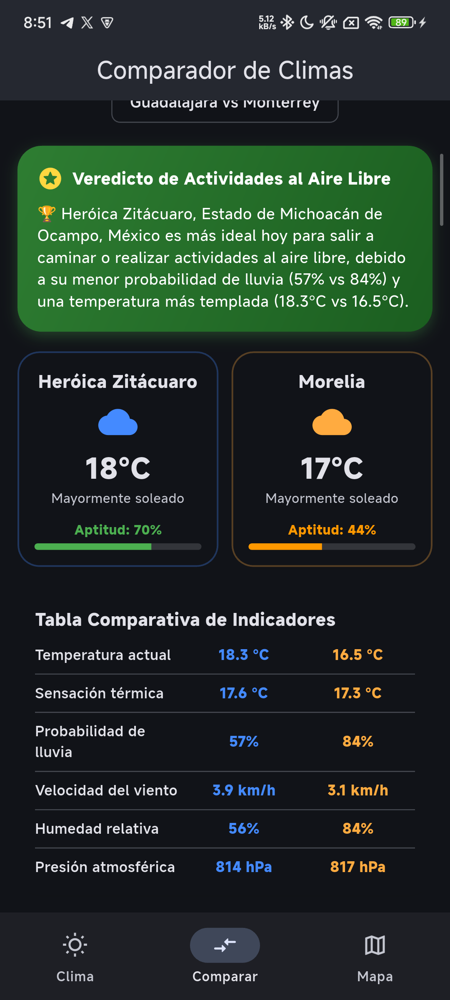
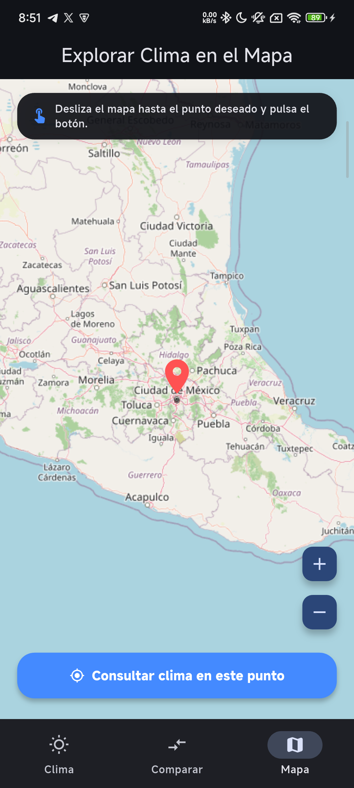
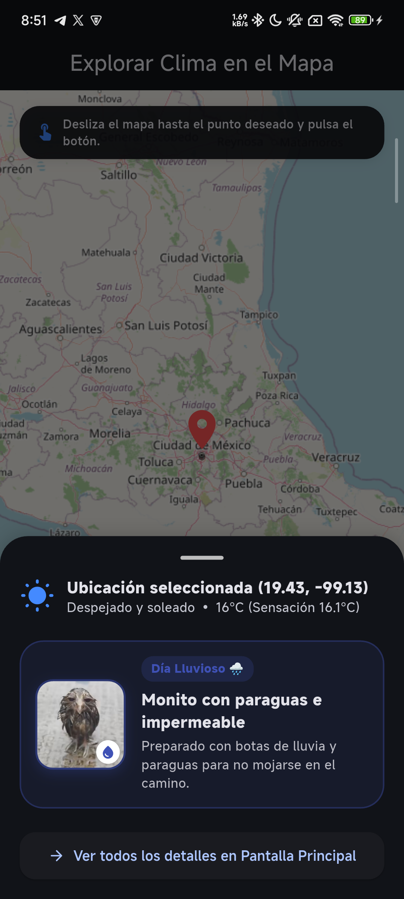
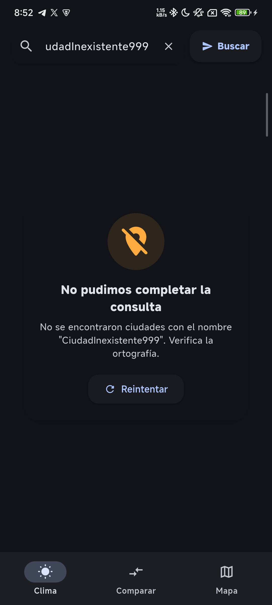

# CliMap — Aplicación Móvil de Pronóstico del Clima en Flutter

Aplicación móvil multiplataforma desarrollada en **Flutter** que consulta información meteorológica en tiempo real mediante una API externa ([Open-Meteo](https://open-meteo.com/)) con diseño adaptable (*responsive*), soporte de tema claro/oscuro y funcionalidades diferenciadoras orientadas a la experiencia del usuario.

---

## Características principales

* **Consulta meteorológica completa:**
  * Temperatura actual, sensación térmica y descripción en español (códigos WMO).
  * Humedad relativa, probabilidad de lluvia, velocidad del viento y presión atmosférica.
  * Pronóstico de los próximos **7 días** con temperaturas máxima/mínima y probabilidad de precipitación.
* **Buscador inteligente de ciudades:**
  * Autocompletado en tiempo real con *debounce* (350 ms) y descarte de respuestas obsoletas.
  * Chips de acceso rápido en la pantalla de bienvenida.
* **Validación y manejo robusto de errores:**
  * Mensajes diferenciados y botón de reintento para **sin conexión a internet**, **ciudad no encontrada** y **error o tiempo de espera del servidor**.
* **Recomendaciones personalizadas según el clima:**
  * Consejos prácticos automáticos (protector solar e hidratación ante calor, paraguas ante lluvia, abrigo ante frío, precaución por viento o tormenta eléctrica).
* **Diseño adaptable (*responsive*) y tema del sistema:**
  * Navegación adaptativa (`NavigationBar` inferior en móviles y `NavigationRail` lateral en pantallas anchas ≥ 720 px) y diseño de 1 o 2 columnas mediante `LayoutBuilder`.
  * Soporte automático para **modo claro y modo oscuro** (Material 3).

---

## Diferenciador innovador

1. **Notificación flotante climática con memes (*Monito Climático*):**
   * Al consultar una ciudad, se despliega una notificación flotante animada en la parte superior de la pantalla con un meme acorde al clima actual (lluvioso, caluroso, frío, ventoso o templado) y la recomendación principal.
   * La tarjeta del meme puede tocarse (desde la pantalla principal o la notificación) para ampliarla con más detalle.
2. **Comparador de ciudades con Índice de Aptitud al Aire Libre:**
   * Permite comparar dos ciudades simultáneamente, calcula un puntaje de **0 a 100%** según lluvia, temperatura y viento, y genera un veredicto indicando cuál es más recomendable para salir.
3. **Explorador en Mapa Mundial Interactivo:**
   * Mapa interactivo basado en **OpenStreetMap** (`flutter_map`) con mira central para consultar el clima en cualquier coordenada del planeta y abrir sus detalles completos en la pantalla principal.

---

## Capturas de pantalla

> Capturas reales ejecutando el APK *release* en dispositivo físico Android 15 (`23124RA7EO`).

| Inicio y búsqueda rápida | Clima actual y meme climático | Detalles, consejos y pronóstico |
| :---: | :---: | :---: |
|  |  |  |

| Meme ampliado al tocar | Notificación flotante (Frío) | Notificación flotante (Calor) |
| :---: | :---: | :---: |
|  |  |  |

| Comparador de ciudades | Tabla comparativa | Mapa interactivo |
| :---: | :---: | :---: |
|  |  |  |

| Consulta desde el mapa | Manejo de errores |
| :---: | :---: |
|  |  |

---

## Tecnologías y APIs utilizadas

* **Framework:** Flutter (Dart SDK `^3.13.2`)
* **Gestión de estado:** `flutter_bloc` (`ClimaBloc` y `ComparacionCubit`) + `equatable`
* **Red y mapas:** `http`, `flutter_map`, `latlong2`
* **APIs externas (sin API Key requerida):**
  * [Open-Meteo Geocoding API](https://open-meteo.com/en/docs/geocoding-api) (búsqueda de ciudades)
  * [Open-Meteo Weather Forecast API](https://open-meteo.com/en/docs) (clima actual y pronóstico de 7 días)
  * [OpenStreetMap Tiles](https://www.openstreetmap.org/) (mapa interactivo)

---

## Estructura del proyecto

```text
lib/
├── main.dart                                # Configuración global, tema y BLoCs
├── bloc/
│   ├── clima_bloc.dart                      # Lógica de consulta, sugerencias y reintentos
│   ├── clima_event.dart                     # Eventos de búsqueda, mapa y reintento
│   ├── clima_state.dart                     # Estado del clima y errores tipificados
│   └── comparacion_cubit.dart               # Lógica del comparador entre dos ciudades
├── modelos/
│   ├── ciudad_modelo.dart
│   ├── clima_modelo.dart
│   ├── pronostico_modelo.dart
│   └── recomendacion_modelo.dart
├── servicios/
│   └── clima_api_servicio.dart              # Cliente HTTP Open-Meteo y manejo de excepciones
├── utilidades/
│   ├── clima_traductor.dart                 # Códigos WMO a texto, iconos y gradientes
│   ├── evaluador_actividades.dart           # Cálculo de aptitud al aire libre y veredicto
│   └── recomendador_clima.dart              # Reglas de recomendaciones personalizadas
└── vistas/
    ├── pantalla_principal.dart              # Navegación adaptable móvil/tablet
    ├── vista_clima_principal.dart
    ├── vista_comparacion.dart
    ├── vista_mapa.dart
    └── widgets/
        ├── buscador_ciudades_widget.dart
        ├── lista_pronostico_widget.dart
        ├── lista_recomendaciones_widget.dart
        ├── monito_clima_widget.dart
        ├── notificacion_clima_overlay.dart
        ├── rejilla_detalles_clima.dart
        └── tarjeta_clima_actual.dart
```

---

## Cómo ejecutar el proyecto

```bash
# 1. Instalar dependencias
flutter pub get

# 2. Verificar análisis estático y pruebas unitarias/widget
flutter analyze
flutter test

# 3. Ejecutar en dispositivo o emulador
flutter run

# 4. Compilar APK release para Android
flutter build apk --release
```
