<div align="center">

# ☀️ CliMap

**Aplicación móvil de pronóstico del clima en Flutter con memes climáticos dinámicos, comparador de ciudades y mapa mundial interactivo.**


[Características](#-características-principales) · [Diferenciador](#-diferenciador-innovador) · [Capturas](#-capturas-en-dispositivo-real) · [Arquitectura](#-arquitectura-y-tecnologías) · [Instalación](#-instalación-y-ejecución)

</div>

---

## 📋 Descripción

**CliMap** consulta condiciones meteorológicas en tiempo real y pronósticos de 7 días conectándose a las APIs externas gratuitas de **Open-Meteo** (sin necesidad de API Key) y **OpenStreetMap**. Su interfaz sigue **Material Design 3**, se adapta automáticamente a distintos tamaños de pantalla y soporta **tema claro y oscuro** del sistema.

---

## ✨ Características principales

| Categoría | Qué ofrece la aplicación |
| :--- | :--- |
| **Clima actual completo** | Temperatura actual, sensación térmica, ubicación completa, descripción del clima (códigos WMO en español), humedad relativa, presión atmosférica (`hPa`), velocidad del viento (`km/h`) y probabilidad de lluvia (`%`). |
| **Pronóstico extendido** | Tarjetas horizontales para los próximos **7 días** con temperaturas máxima/mínima, icono de condición y probabilidad de precipitación. |
| **Buscador inteligente** | Autocompletado de ciudades con *debounce* de `350 ms`, cancelación de respuestas obsoletas y chips de acceso rápido en la bienvenida. |
| **Manejo robusto de errores** | Detección diferenciada con mensajes claros y botón **Reintentar** para *sin conexión a internet*, *ciudad no encontrada* y *error/tiempo de espera del servidor*. |
| **Recomendaciones personalizadas** | Consejos prácticos automáticos según las condiciones actuales (protector solar e hidratación en calor, paraguas en lluvia, abrigo en frío, precaución por viento o tormenta). |
| **Diseño adaptable (*Responsive*)** | Cambia entre `NavigationBar` inferior (móviles `< 720 px`) y `NavigationRail` lateral (tablets/pantallas anchas `≥ 720 px`), además de diseño de 1 o 2 columnas en la vista principal (`600 px`). |

---

## 🚀 Diferenciador innovador

Además de cubrir todas las métricas meteorológicas estándar, **CliMap** integra tres experiencias propias que aportan valor y dinamismo:

### 1. Memes Climáticos Dinámicos (*Monito Climático*)
Tarjeta visual temática (`MonitoClimaWidget`) que adapta su imagen, paleta de color y consejo según la temperatura, lluvia o viento de la ciudad consultada:

| Estado climático | Condición de activación | Acción del meme | Vista |
| :--- | :--- | :--- | :---: |
| **Día Lluvioso 🌧️** | Prob. lluvia ≥ 40% o código WMO de lluvia/tormenta | Monito con paraguas e impermeable |  |
| **Día Caluroso ☀️** | Temperatura ≥ 26 °C | Monito poniéndose protector solar |  |
| **Día Frío ❄️** | Temperatura < 15 °C | Monito bien abrigado |  |
| **Día Ventoso 💨** | Velocidad del viento ≥ 22 km/h | Monito sujetando su sombrero | 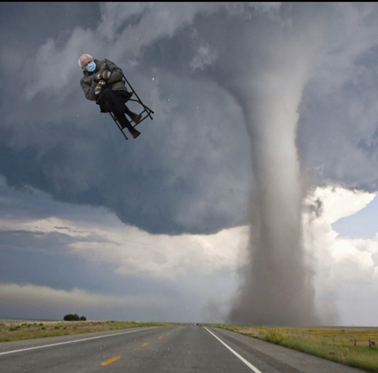 |
| **Clima Agradable 🌤️** | Condiciones templadas estables | Monito paseando relajado |  |

### 2. Comparador de Ciudades + Índice de Aptitud al Aire Libre
Compara dos ciudades al mismo tiempo, evalúa lluvia, temperatura ideal y viento para calcular un **puntaje de aptitud de 0 a 100%**, emite un **veredicto automático** y muestra una tabla comparativa con los 6 indicadores clave.

### 3. Explorador Climático en Mapa Mundial
Mapa interactivo basado en **OpenStreetMap** (`flutter_map`) donde puedes desplazarte libremente, ubicar cualquier punto del planeta bajo la mira central, previsualizar su clima y enviarlo directo a la pantalla principal.

---

## 📱 Capturas en dispositivo real

> Capturas tomadas ejecutando el APK *release* de CliMap en dispositivo físico Android 15 (`23124RA7EO`).

### Clima principal, detalles y pronóstico

<div align="center">

| Inicio y búsqueda rápida | Clima actual y meme lluvioso | Detalles, consejos y 7 días |
| :---: | :---: | :---: |
|  | 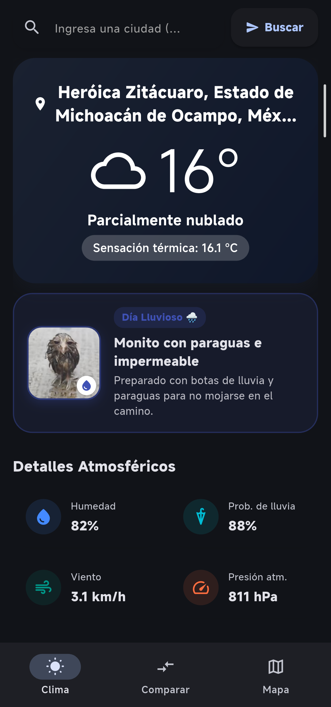 | 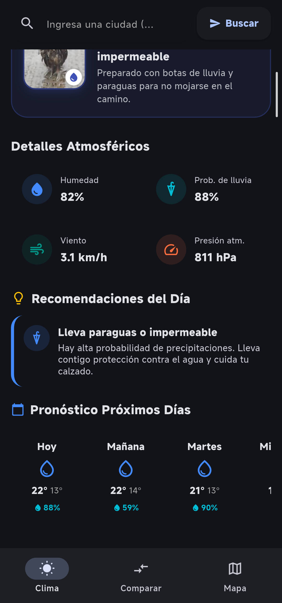 |

</div>

### Memes dinámicos según el clima de cada ciudad

<div align="center">

| Clima frío (Oslo, 0 °C) | Clima caluroso (Bangkok, 31 °C) |
| :---: | :---: |
| 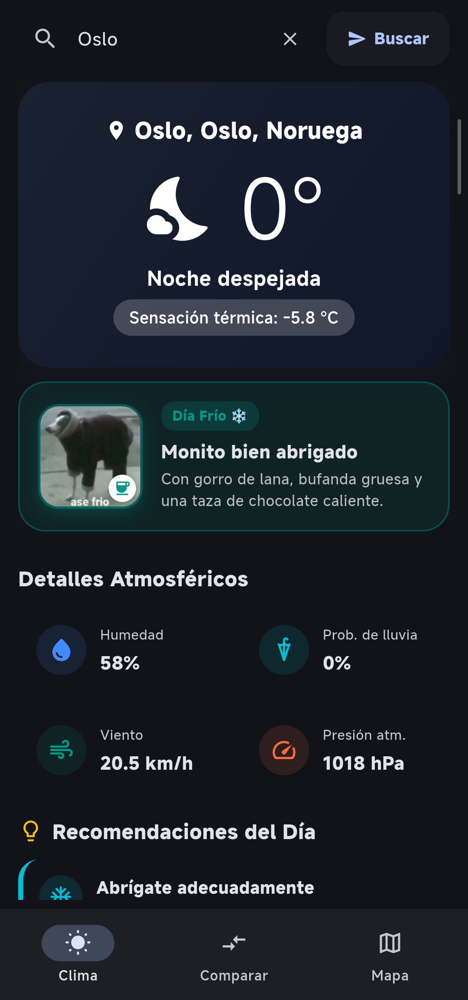 | 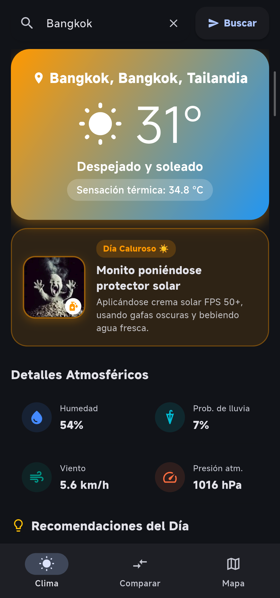 |

</div>

### Comparador de ciudades

<div align="center">

| Veredicto y puntaje de aptitud | Tabla comparativa de indicadores |
| :---: | :---: |
| 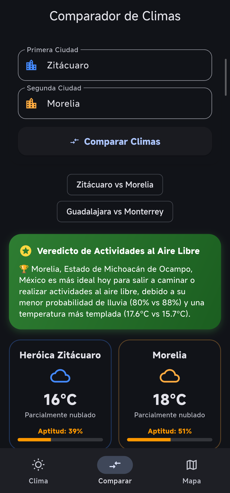 | 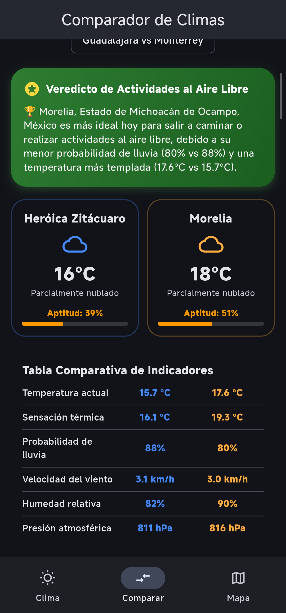 |

</div>

### Mapa mundial interactivo y manejo de errores

<div align="center">

| Mapa mundial (OpenStreetMap) | Consulta de coordenadas en mapa | Validación ciudad no encontrada |
| :---: | :---: | :---: |
| 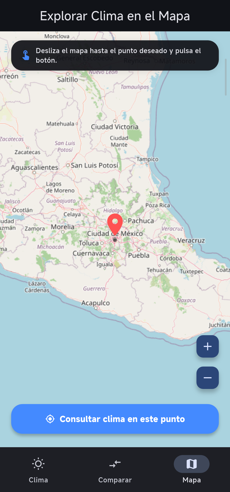 | 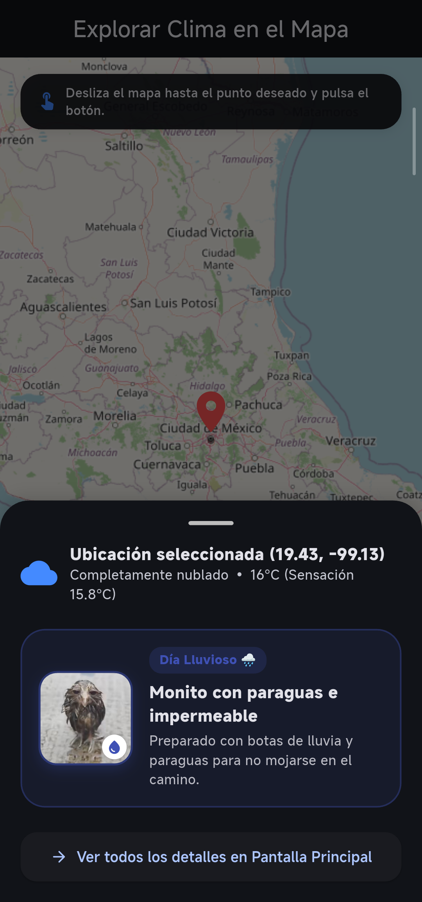 | 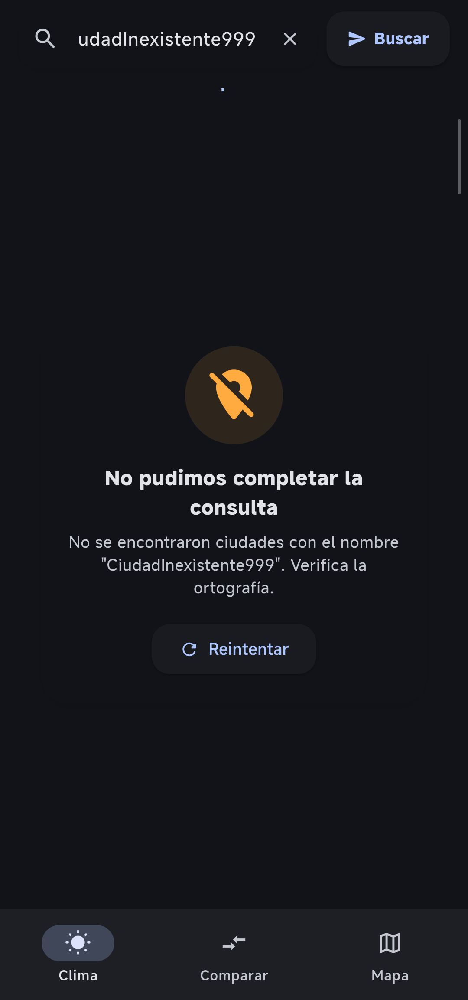 |

</div>

---

## 🏗️ Arquitectura y tecnologías

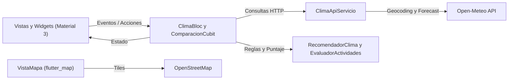

### Stack técnico
* **Gestor de estado:** [`flutter_bloc`](https://pub.dev/packages/flutter_bloc) (`^8.1.6`) + [`equatable`](https://pub.dev/packages/equatable) (`^2.0.5`)
* **Cliente HTTP:** [`http`](https://pub.dev/packages/http) (`^1.2.2`)
* **Mapas:** [`flutter_map`](https://pub.dev/packages/flutter_map) (`^8.3.2`) + [`latlong2`](https://pub.dev/packages/latlong2) (`^0.9.1`)
* **APIs externas (sin API Key):**
  * [Open-Meteo Geocoding API](https://open-meteo.com/en/docs/geocoding-api)
  * [Open-Meteo Weather Forecast API](https://open-meteo.com/en/docs)
  * [OpenStreetMap Tiles](https://www.openstreetmap.org/)

<details>
<summary><strong>📂 Ver estructura de carpetas del proyecto</strong></summary>

```text
lib/
├── main.dart                                # Configuración Material 3, tema claro/oscuro y BLoCs
├── bloc/
│   ├── clima_bloc.dart                      # Búsqueda, consulta por ciudad/mapa y reintentos
│   ├── clima_event.dart                     # Eventos del flujo principal
│   ├── clima_state.dart                     # Estado inmutable del clima y errores tipificados
│   └── comparacion_cubit.dart               # Comparación simultánea de dos ciudades
├── modelos/
│   ├── ciudad_modelo.dart                   # Resultado de geocodificación
│   ├── clima_modelo.dart                    # Clima actual + pronóstico semanal
│   ├── pronostico_modelo.dart               # Modelo diario de 7 días
│   └── recomendacion_modelo.dart            # Tarjeta de recomendación personalizada
├── servicios/
│   └── clima_api_servicio.dart              # Peticiones Open-Meteo y clasificación de errores
├── utilidades/
│   ├── clima_traductor.dart                 # Códigos WMO a texto, iconos y gradientes
│   ├── evaluador_actividades.dart           # Índice de aptitud (0-100%) y veredicto
│   └── recomendador_clima.dart              # Motor de recomendaciones según clima
└── vistas/
    ├── pantalla_principal.dart              # Contenedor responsive (NavigationBar / NavigationRail)
    ├── vista_clima_principal.dart           # Pantalla principal del clima
    ├── vista_comparacion.dart               # Comparador de ciudades
    ├── vista_mapa.dart                      # Mapa mundial interactivo
    └── widgets/
        ├── buscador_ciudades_widget.dart    # Campo de búsqueda con debounce y sugerencias
        ├── lista_pronostico_widget.dart     # Carrusel horizontal de 7 días
        ├── lista_recomendaciones_widget.dart
        ├── monito_clima_widget.dart         # Tarjeta visual temática con memes climáticos
        ├── rejilla_detalles_clima.dart      # Humedad, lluvia, viento y presión
        └── tarjeta_clima_actual.dart        # Tarjeta principal con gradiente dinámico
```

</details>

---

## 🛠️ Instalación y ejecución

```bash
# 1. Clonar el repositorio
git clone https://github.com/JovaniTL/Climap_flutter.git
cd Climap_flutter

# 2. Instalar dependencias
flutter pub get

# 3. Ejecutar análisis estático y pruebas unitarias/widget
flutter analyze
flutter test

# 4. Ejecutar en dispositivo o emulador
flutter run

# 5. Generar APK release para Android
flutter build apk --release
```
